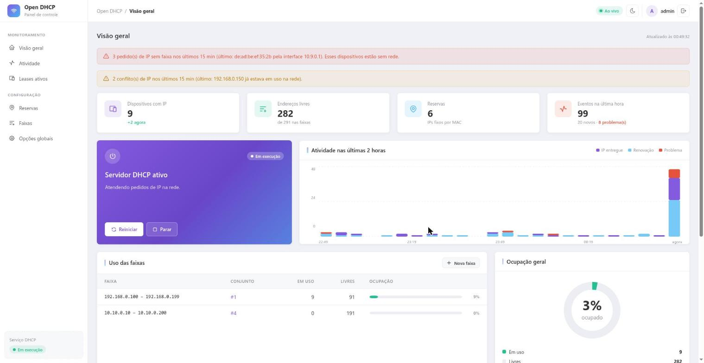
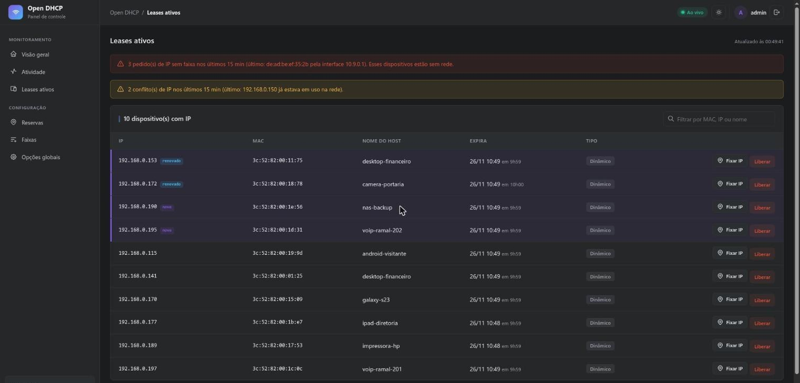

# opendhcp-panel

> Painel do [Open DHCP Server](http://dhcpserver.sourceforge.net/), servidor DHCP de **Achal Dhir**
> (© 2005, GPL v2). Este repositório é um fork de
> [ss-plus/Open-DHCP-Server](https://github.com/ss-plus/Open-DHCP-Server); o servidor (`opendhcpd`)
> continua o original, sem alterações.

Painel web de administração e monitoramento em tempo real para o Open DHCP Server, escrito em
Rust. É um programa separado: **o servidor DHCP (`opendhcpd`) não muda**. O painel:

- mostra **ao vivo** (Server-Sent Events, sem recarregar a página) os dispositivos com IP, a
  ocupação das faixas, o estado do serviço e os eventos do servidor;
- edita o `opendhcp.ini` (reservas, faixas e opções globais), **preservando comentários e a ordem**
  do arquivo e fazendo backup antes de cada gravação;
- inicia, para e reinicia o serviço por comandos configuráveis (por padrão `systemctl`).





## Telas

| Tela | O que faz |
|---|---|
| Visão geral | Cartão do serviço (Iniciar/Parar/Reiniciar), indicadores, gráfico de eventos das últimas 2 h, uso das faixas, ocupação geral, **ocupação ao longo do tempo** (24 h ou 7 dias, medida a cada 5 min, com o pico) e atividade recente |
| Atividade | Feed ao vivo do log do servidor: IP entregue, renovação, oferta, liberação, conflito, recusa, pedido sem faixa; filtros por tipo e texto. **Dias anteriores** pelo calendário (histórico em disco) |
| Leases ativos | Dispositivos com IP agora, com destaque para os **novos** e **renovados**, fabricante pelo MAC (ou "MAC aleatório") e apelido; **Fixar IP** (vira reserva) e **Liberar** |
| Dispositivo | Clicando num MAC: fabricante, situação atual, reserva, histórico de eventos daquele aparelho, e **apelido e anotações** (guardados em `data_dir/devices.json`, fora do `.ini`) |
| Reservas | IP fixo por MAC (`[00:11:22:33:44:55]` + `IP=`), nome do host, bloqueio de dispositivo, se está com IP agora. Botão **IP livre** sugere o primeiro IP disponível; aviso (e recusa ao salvar) se o IP estiver com outro dispositivo. **Importar/exportar CSV** (`mac,ip,hostname`, tudo ou nada) |
| Faixas | `[RANGE_SET]`: faixas `DHCPRange`, máscara, gateway, DNS e tempo de lease, com a ocupação de cada faixa. Máscara por prefixo (/8 a /32), faixa pelo primeiro IP + quantidade, rede/broadcast/IPs utilizáveis calculados ao digitar, lease em minutos/horas/dias |
| Opções globais | `[GLOBAL_OPTIONS]`: domínio, máscara, gateway, DNS e lease padrão |
| Backups | Cópias do `.ini` feitas antes de cada alteração: quanto cada uma difere do arquivo atual, **comparação linha a linha** e **restauração** (o arquivo atual também ganha backup antes) |
| Minha conta | Troca o usuário e a senha do painel (grava o novo hash no `panel.toml` e encerra as outras sessões) |

**Idiomas:** português, inglês, francês e espanhol. O seletor (globo, ao lado do sino) fica no
topo de todas as telas e no login; a escolha vale por 1 ano (cookie `odp_lang`). Na primeira
visita o painel usa o idioma do navegador (`Accept-Language`) e, se não for nenhum desses, o
português.

**Alertas** no topo de todas as telas: serviço parado, faixa com 80%/90% ocupada, pedidos de IP
sem faixa correspondente (dispositivos sem rede) e conflitos de IP nos últimos 15 minutos.

Opções que o painel não edita (filtros, opções numéricas, PXE etc.) aparecem como "outras
opções" e são mantidas no arquivo exatamente como estão. O servidor só lê o `.ini` ao iniciar,
então alterações valem depois de **Reiniciar** (o painel mostra um aviso com o botão). Os leases
ativos não se perdem: o servidor os grava no arquivo de estado e relê ao subir.

## Como o tempo real funciona

Um monitor no painel confere a cada segundo:

- o **arquivo de estado** (`-s`), que o servidor regrava a cada IP entregue ou renovado;
- o **log** (`-l`, com `%Y%m%d`): lê só as linhas novas, troca de arquivo na virada do dia e, ao
  iniciar, carrega o fim do log de hoje e de ontem para o histórico;
- o **estado do serviço** (a cada 3 s).

Quando algo muda, cada navegador conectado em `/live` recebe só os blocos da página aberta,
já renderizados (e escapados) no servidor. Se a conexão cair, a página tenta de novo sozinha e
volta para o login se a sessão tiver expirado.

## Aplicativo Open DHCP (janela própria)

O painel também abre como aplicativo, numa janela própria (sem navegador): **Open DHCP**, no
menu de aplicativos. Ele usa o WebView do sistema (WebKitGTK no Linux, WebView2 no Windows).

- **Linux, com o pacote instalado:** a janela mostra o painel do serviço `opendhcp-panel`. Se o
  serviço estiver parado, aparece um botão para iniciá-lo (pede a senha do sistema).
- **Windows, ou Linux sem o serviço:** o painel roda dentro do próprio aplicativo, com a
  configuração em `<pasta de configuração do usuário>/OpenDHCP/panel.toml`, criada na primeira
  vez.
- `open-dhcp --url http://servidor:8067/` abre um painel em outro endereço;
  `open-dhcp --config arquivo.toml` usa outra configuração.
- Arquivos baixados (ex.: exportar reservas em CSV) vão para a pasta Downloads.

## Pacotes

`packaging/build-release.sh` gera, em `dist/release-<versão>/`, os pacotes `.deb`, `.rpm`,
`.AppImage`, `.tar.gz` (Linux) e `.zip` (Windows). Os pacotes Linux instalam o `opendhcpd`
(compilado em 64 bits) em `/opt/opendhcp`, o painel como serviço (`opendhcp-panel`, já ligado
depois da instalação, usuário `admin` e senha `admin`), o aplicativo Open DHCP e as units do
systemd. O servidor DHCP em si (`opendhcp`) não é iniciado sozinho: ajuste o `opendhcp.ini` pelo
painel e clique em Iniciar.

O `.AppImage` leva o `opendhcpd` e o `opendhcp-panel` dentro. Na primeira vez que roda num Linux
sem o servidor instalado, o aplicativo oferece instalá-lo (pede a senha de administrador uma vez,
via `pkexec`): `opendhcpd` em `/opt/opendhcp`, `opendhcp-panel` em `/usr/local/bin`, as duas units
em `/etc/systemd/system` e a configuração em `/etc/opendhcp-panel`, sem sobrescrever arquivos que
já existam. Quem preferir não instalar pode continuar com o painel embutido.

## Instalação manual

```sh
cargo build --release
sudo install -m 755 target/release/opendhcp-panel /usr/bin/
sudo mkdir -p /etc/opendhcp-panel
sudo cp panel.example.toml /etc/opendhcp-panel/panel.toml
echo admin | opendhcp-panel hash-password   # cole o hash em [auth] password_hash
sudo cp opendhcp.service opendhcp-panel.service /etc/systemd/system/
sudo systemctl daemon-reload
sudo systemctl enable --now opendhcp opendhcp-panel
```

Ajuste em `panel.toml` os caminhos `ini_file`, `state_file` e `log_file` para os mesmos usados no
`opendhcpd` (`-i`, `-s` e `-l`). O painel abre em `http://127.0.0.1:8067`.
Com a senha de fábrica `admin`, todas as telas mostram um aviso até ela ser trocada em
**Minha conta**.

## Segurança

- **Login:** senha em hash Argon2id; sessão em cookie `HttpOnly` + `SameSite=Strict`, trocada a
  cada login e depois de mudar a senha; token CSRF em todo formulário.
- **Senha padrão:** com `admin`, o painel só deixa abrir **Minha conta** até ela ser trocada.
- **Tentativas:** bloqueio de 5 minutos após 5 senhas erradas pelo mesmo IP, contando um login
  por vez (tentativas em paralelo não escapam do limite). Atrás de um proxy, liste-o em
  `trusted_proxies` para valer o IP real do cliente.
- **DNS rebinding:** só são aceitos pedidos com `Host` de endereço IP, `localhost` ou um dos
  `allowed_hosts`, e POST só da mesma origem; uma página da internet não consegue falar com o
  painel local.
- **Injeção:** tudo o que vem dos dispositivos é escapado no HTML; CSP sem script nem estilo
  inline; entradas validadas (MAC, IPv4, máscara, faixas, nomes) e valores com quebra de linha
  recusados, para não injetar seções no `.ini`; CSV exportado protegido contra fórmulas.
- **Arquivos:** gravações atômicas com temporário exclusivo e permissão restrita desde a criação;
  estado dos leases em `/var/lib/opendhcp` (fora do `/tmp`); backups em pasta 0700.
- **Serviços:** as units do systemd tiram os poderes de root que não são usados (o `opendhcpd`
  fica só com a porta 67), deixam o sistema só leitura fora das pastas de dados e isolam `/tmp`,
  dispositivos e kernel.
- **Aplicativo:** no modo embutido, entra por um link de uso único e a senha do painel é
  aleatória; ações internas só valem na tela de aviso local, e a janela não navega para fora do
  painel.
- Se o `.ini` mudar entre abrir e salvar um formulário, a gravação é recusada.
- Ouve só em `127.0.0.1` por padrão. Para acesso remoto, use um proxy com HTTPS,
  `secure_cookie = true` (liga também o HSTS) e o nome publicado em `allowed_hosts`.

## Traduções

Os textos ficam em português no código, marcados com `t("...")`, `tf!("... {}", valor)`,
`tm(...)` (com HTML), `n_("...")` (constantes) ou `msg!(...)` (mensagens traduzidas na hora de
mostrar). As traduções estão em `src/i18n_table.rs`, uma linha por texto:
`[português, inglês, francês, espanhol]`. O `cargo test` falha se algum texto marcado ficar sem
tradução, se sobrar tradução sem uso ou se o número de `{}` não bater.

## Desenvolvimento

```sh
cargo test     # INI, arquivo de estado (struct data8, 104 bytes), log, monitor, alertas, login
cargo run -- serve -c panel.toml
```

Para testar sem root/DHCP real, aponte os comandos de `[service]` para um script que simule o
serviço e use uma cópia do `opendhcp.ini`; um script que escreva linhas no log e regrave o
arquivo de estado (no formato acima) faz a tela se mexer como num servidor de verdade.

**Histórico:** os eventos do log ficam num SQLite em `data_dir/history.sqlite` (por padrão, 90
dias; `history_days`), sem duplicar quando o mesmo trecho do log é relido. Ele alimenta os dias
anteriores da tela Atividade e o histórico de cada dispositivo, e guarda as notificações fechadas
para não voltarem quando o painel reinicia.

Limitações atuais: o layout do arquivo de estado é o do Linux 64 bits (x86_64/aarch64); o painel
não edita `[LISTEN_ON]`, `[REPLICATION_SERVERS]` nem filtros de faixa.
